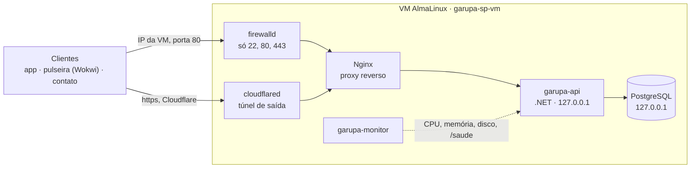

# Garupa SP: infraestrutura

Infraestrutura da API do **Garupa SP**, feita para a disciplina de Operating Systems (FIAP, Global Solution 2026.2).

O Garupa SP é um app para motociclistas entregadores de São Paulo. Ele alerta sobre pontos críticos de sinistro, detecta queda e envia um SOS ao contato de emergência. Tudo isso depende de uma API no ar: se ela cair, o socorro não sai. Este repositório mantém essa API funcionando.

Um conjunto de scripts Bash transforma uma VM **AlmaLinux 9 ou 10** vazia num servidor completo, sem configuração manual: banco de dados, API, proxy reverso, monitoramento, auditoria e acesso público.

## Integrantes

| Nome | RM |
| --- | --- |
| Caio Alexandre dos Santos | 558460 |
| Leandro do Nascimento Souza | 558893 |
| Rafael de Mônaco Maniezo | 556079 |
| Vinicius Rozas Pannuci de Paula Cont | 555338 |

## Como a requisição chega à API



Só o Nginx fala com o mundo. A API e o banco escutam apenas dentro da VM, e o monitor vigia tudo a cada 15 segundos.

## O que a infraestrutura garante

**Sobe sozinha.** Um único comando (`provisionar.sh`) leva a VM do zero ao ambiente funcionando. Os scripts são idempotentes: rodar de novo não estraga nada, só corrige o que estiver fora do lugar.

**Volta sozinha.** A API e o monitor são serviços do `systemd`. Se a API morrer, o `systemd` a reinicia em segundos. Se ela estiver ativa mas travada, o monitor percebe pelo `/saude` e a reinicia. Cada deploy fica numa pasta própria: se a versão nova não responder, o script volta para a anterior.

**Avisa quando algo sai do normal.** O `garupa-monitor` mede CPU, memória, disco e a saúde da API. Passou do limite (80%, 80% e 85%), grava um `ALERTA`. Quando volta ao normal, grava `NORMALIZADO`. Opcionalmente envia o alerta para um webhook do Discord.

**Registra quem fez o quê.** Toda execução de script vai para a auditoria: quem rodou, quando, cada etapa e o resultado. O `auditd` registra qualquer alteração nas configurações e nos segredos em `/etc/garupa`.

**Não expõe ninguém.** Nenhum log guarda dado pessoal: o Nginx grava os acessos sem query string, sem tokens e com o IP anonimizado. As senhas são geradas na própria VM e nunca vão para o Git nem para a tela.

**Fecha o que não precisa estar aberto.** O firewall libera só SSH, HTTP e HTTPS. O SELinux fica em modo `Enforcing`. A API e o monitor rodam com usuários próprios, sem shell e sem senha. O monitor só tem permissão de sudo para reiniciar a API, nada além disso.

**Fica acessível de fora.** Um túnel do Cloudflare dá à API um endereço `https` público, mesmo com a VM sem IP público. É assim que o app e a pulseira no Wokwi chegam até ela.

**Prova que funciona.** Um script confere cerca de 30 pontos do ambiente sem alterar nada. Outro provoca falhas de propósito (mata a API, estressa CPU, memória e disco, derruba o banco) para mostrar a recuperação acontecendo.

## Os scripts

| Script | Papel |
| --- | --- |
| `01_infra.sh` | Prepara a máquina: nome, fuso e NTP, rede e DNS, pacotes, firewall, SELinux, usuários de serviço e logs |
| `02_app.sh` | Sobe a aplicação: .NET, PostgreSQL, segredos, API como serviço, carga da tabela de risco e Nginx |
| `03_monitor.sh` | Instala o monitor como serviço, com limites configuráveis |
| `04_verificar.sh` | Confere todo o ambiente e mostra OK ou FALHOU em cada item |
| `05_teste_falha.sh` | Provoca falhas: `api`, `monitor`, `cpu`, `memoria`, `disco`, `banco` ou `todos` |
| `06_tunel.sh` | Publica a API na internet pelo túnel do Cloudflare |
| `provisionar.sh` | Roda do 01 ao 04 em sequência |

Para montar o ambiente:

```bash
sudo dnf -y install git
git clone https://github.com/Leandrns/garupa-sp-infra.git && cd garupa-sp-infra
cp config/garupa.conf.example config/garupa.conf
sudo bash provisionar.sh
```

## Onde ficam os registros

| Onde | O quê |
| --- | --- |
| `/var/log/garupa/auditoria.log` | Quem rodou cada script, quando e com que resultado |
| `/var/log/garupa/execucao.log` | Saída completa dos scripts |
| `/var/log/garupa/monitor.log` | Medições do monitor a cada ciclo |
| `/var/log/garupa/alertas.log` | `ALERTA`, `NORMALIZADO` e as ações do monitor |
| `/var/log/nginx/garupa-acesso.log` | Acessos à API, sem dados pessoais |
| `ausearch -k garupa-config -i` | Alterações em `/etc/garupa`, pelo `auditd` |

O `journal` do sistema fica gravado em disco, e o `logrotate` gira todos esses arquivos para que não encham o disco.

## Organização do repositório

```
├── 01_infra.sh … 06_tunel.sh, provisionar.sh
├── config/garupa.conf.example   configuração (a cópia garupa.conf não vai para o Git)
├── lib/comum.sh                 funções compartilhadas: mensagens, auditoria, segredos
├── monitor/garupa-monitor.sh    o monitor
├── templates/                   serviços systemd, Nginx, logrotate, auditd, sudoers, journald
├── dados/risco_celula.csv       tabela de risco gerada pelo modelo de ML
├── api-ensaio/                  API mínima para testar a infra sem a API oficial
└── evidencias/                  prints e logs da demonstração
```

A API em si fica no repositório [caio-alex/garupa-sp-api](https://github.com/caio-alex/garupa-sp-api). O `02_app.sh` baixa, compila e publica a versão mais recente dela.
